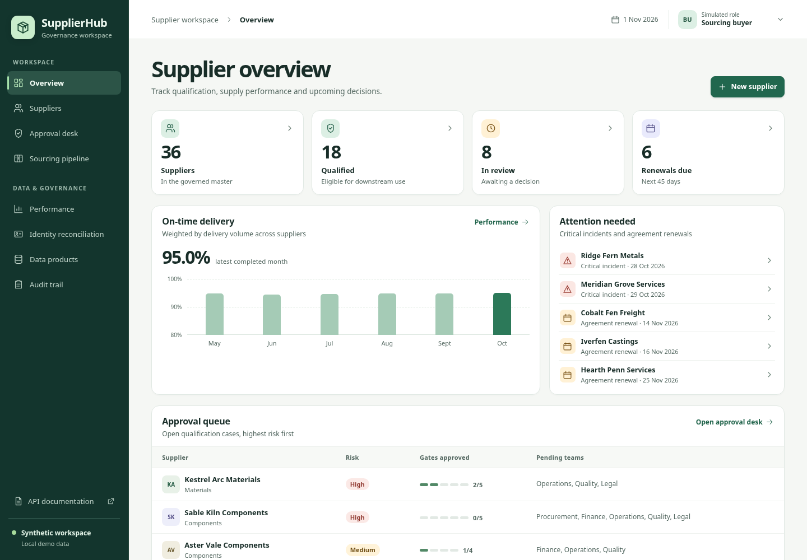
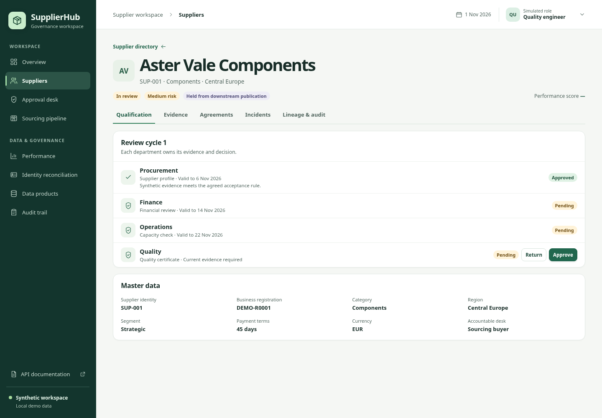
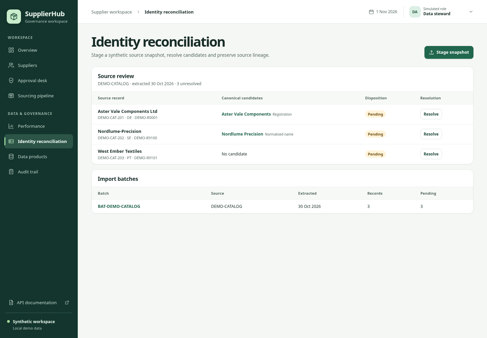
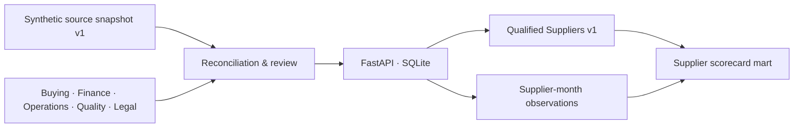

# SupplierHub

**Supplier qualification, commercial decisions and governed supplier data.**

SupplierHub is an independent synthetic product for a fictional industrial buying network. Buying, Finance, Operations and Quality work from the same supplier record, with clear decisions and evidence ownership. Legal joins enhanced reviews and controls agreement activation. Finance and Analytics can reuse eligible supplier data under a versioned contract.



## What you can do

| Workspace | Working capability |
| --- | --- |
| **Supplier directory** | Create and edit supplier profiles. Search and filter stable identities, classifications, risk and payment terms. |
| **Approval desk** | Submit a candidate and review it across four core functions. Add a fifth Legal gate for high-risk suppliers. Current evidence, revision checks and reasoned decisions control activation. |
| **Agreements and incidents** | Propose and approve agreements, track renewals, and assign incidents for remediation. A critical incident suspends eligible suppliers and active reviews. |
| **Sourcing pipeline** | Advance an item or service initiative from discovery to commercial award. Procurement award requires current qualification and an effective agreement. |
| **Identity reconciliation** | Stage a versioned source snapshot. Link reviewed country/registration matches, queue uncertain identities and trace each resolution. |
| **Performance and data products** | Verify count-weighted scorecards and data freshness. Download the allowlisted eligible supplier feed, then run the warehouse model locally. |

| Qualification | Identity reconciliation |
| --- | --- |
|  |  |

[Mobile supplier directory](assets/04-mobile.png) · [Data product and health](assets/05-data-product.png) · [Review walkthrough](docs/walkthrough.md) · [Product case study](docs/product.md)

## Run

Requires **Python 3.12**. From the repository root:

```bash
python -m venv .venv
source .venv/bin/activate
python -m pip install -r requirements.txt
python -m uvicorn supplierhub.app:app --host 127.0.0.1 --port 8000 --no-access-log
```

On Windows PowerShell, activate with `.venv\Scripts\Activate.ps1`. Open [the workspace](http://127.0.0.1:8000) or [the interactive API](http://127.0.0.1:8000/docs). The first run seeds 36 fictional suppliers. The local database persists across restarts. Use a new `SUPPLIERHUB_DB` path for a fresh walkthrough.

For a containerized run, use `docker compose up --build --wait`. The app listens on loopback and persists data in a named volume. Set `SUPPLIERHUB_PORT` if port 8000 is occupied.

```bash
python -m pip install -r requirements-dev.txt
python -m playwright install chromium
python -m pytest -q
```

Tests cover role rules, expiry, remediation, concurrent mutations, identity stewardship, persistence, the API and its schemas, live Chromium workflows and contract/warehouse parity. GitHub Actions defines browser and Docker Compose checks.

## How it fits together



The operational service owns the decisions and records them in the same transaction as the audit. The warehouse receives an eligible supplier dimension and additive monthly facts. The documented Snowflake model is checked locally through DuckDB and SQL dialect translation. Live Snowflake and ERP execution remain outside this demo.

## Product ownership and delivery

| Read | Why it matters |
| --- | --- |
| [Product case study](docs/product.md) | Discovery, departmental trade-offs, RACI, stakeholder cadence, release gates and adoption measures |
| [Ranked backlog](docs/backlog.json) | Ten Stories, Enablers and Spikes with business value, dependencies, accepting roles and testable criteria |
| [Technical design](docs/architecture.md) | Decision records, role boundaries, source lineage, observability and contract evolution |
| [Warehouse execution](warehouse/README.md) | Reproducible local scorecards and scope of future Snowflake validation |
| [Release 1.0.0](docs/release.md) | Shipped scope and acceptance evidence |

The role selector simulates decision rights. The application contains synthetic data, runs locally, and requires no corporate credentials. Performance figures reflect the fixture dataset and adoption targets are scenario proposals.
